# Sprout 2.0 — Figma Design & Handoff Specification

> **Purpose of this document:** This specification extracts the exact tokens, typography, spacing, components, layouts, and interactive flows implemented in the working **Sprout 2.0** codebase (`src/`).
>
> ### Live Figma Links
> - **Figma Design File (Editable Frames & Design System):** `https://www.figma.com/design/67FVguQmfCpgOL2XGjKZge/Sprout-2.0-%E2%80%94-Newtonite-UI-UX-Assignment`
> - **Figma Interactive Prototype (Onboarding Flow):** `https://www.figma.com/proto/67FVguQmfCpgOL2XGjKZge/Sprout-2.0-%E2%80%94-Newtonite-UI-UX-Assignment?node-id=1-652&t=cLwORpH5vwAoZTcK-1`

---

## 1. Brand Overview & Visual Direction

- **Brand Name:** Sprout 2.0
- **Tagline:** Small Steps. Big Futures.
- **Product:** A beginner-friendly Indian investing experience starting from **₹100**, designed to make onboarding and KYC preparation calm, transparent, and unintimidating.
- **Visual Direction:**
  - **Editorial, warm minimalism:** Warm cream canvas (`#FFF9F4`) paired with deep forest green (`#0F5132`), soft mint (`#E6F4EA`), and light green (`#CFEFD6`) accents.
  - **Restrained elevation:** Hairline borders (`1px solid rgba(15, 81, 50, 0.10–0.15)`) and soft green-tinted shadows instead of heavy drop shadows or busy gradients.
  - **Friendly, consistent character:** A single Sprout mascot (`design/figma-assets/sprout-mascot.png` / `.webp`) appears in the Homepage Hero, Onboarding Step 1 (Welcome), and Onboarding Step 5 (Verification Pending).
  - **Responsible financial communication:** Mandatory mutual fund market-risk disclaimers are visible above the fold on the homepage and in the footer of every screen (`≥ 14px`, high contrast). No guaranteed returns, fake testimonials, or unverified registration claims are used.

---

## 2. Colour Palette

### 2.1 Core Brand Tokens (Defined in `src/styles/global.css`)

| Token Name | CSS Variable | Tailwind Utility | HEX | RGB | Primary Usage in Code |
|---|---|---|---|---|---|
| **Forest Green** | `--color-forest` | `bg-forest`, `text-forest`, `border-forest` | `#0F5132` | `rgb(15, 81, 50)` | Primary CTA buttons, brand wordmark, step badges, active progress segments, footer background, focus outlines |
| **Mint Green** | `--color-mint` | `bg-mint` | `#E6F4EA` | `rgb(230, 244, 234)` | Hero illustration backdrop, section backgrounds (`bg-mint`, `bg-mint/60`), eyebrow pills, hover states |
| **Light Green** | `--color-light-green` | `bg-light-green` | `#CFEFD6` | `rgb(207, 239, 214)` | Step icon containers, inactive progress segments, demo notice banners (`bg-light-green/50`), text selection highlight |
| **Warm Cream** | `--color-cream` | `bg-cream`, `text-cream` | `#FFF9F4` | `rgb(255, 249, 244)` | Global page background, step cards, button label text on dark green |
| **Charcoal** | `--color-charcoal` | `text-charcoal` | `#1F2937` | `rgb(31, 41, 55)` | Primary headings and body copy |

### 2.2 Functional & Opacity Colors Used in Components (Extracted from `src/`)

| Role | Source Class / Value | Effective Color / HEX | Usage |
|---|---|---|---|
| **Primary CTA Hover** | `hover:bg-[#0b3f27]` (`src/constants.ts`) | `#0B3F27` | Hover fill on primary forest-green buttons |
| **Validation Error Red** | `text-[#B42318]`, `border-[#B42318]` (`src/constants.ts`, `OtpInput.tsx`) | `#B42318` | Field error message text, alert icon fill, invalid input border |
| **Input / Card Surface** | `bg-white`, `bg-white/70`, `bg-white/60` | `#FFFFFF` (100%, 70%, 60%) | Text inputs, OTP boxes, onboarding checklist cards, hero risk note |
| **Body Copy Muted** | `text-charcoal/80` | `rgba(31, 41, 55, 0.80)` (`≈ #4B525C` on cream) | Supporting paragraphs, hints, helper text (maintains `~9.7:1` contrast on `#FFF9F4`) |
| **Subtle Card Border** | `border-forest/10`, `border-forest/15` | `rgba(15, 81, 50, 0.10–0.15)` | Card outlines, section dividers, sticky header border |
| **Input Default Border** | `border-forest/30` (hover: `border-forest/60`) | `rgba(15, 81, 50, 0.30)` | Text inputs, OTP boxes, language selector pill border |

---

## 3. Typography Scale

### 3.1 Font Families (`src/styles/global.css` & `src/main.tsx`)
- **Primary English UI Font:** `Inter Variable` / `Inter` (`@fontsource-variable/inter`)
- **Hindi UI Font:** `Noto Sans Devanagari Variable` / `Noto Sans Devanagari` (`@fontsource-variable/noto-sans-devanagari`, lazy-loaded when `हिंदी` is selected)
- **Fallback Stack:** `system-ui, -apple-system, "Segoe UI", Roboto, sans-serif`

### 3.2 Type Hierarchy (Extracted from Components)

| Style Name | Desktop Size | Mobile Size (`390px`) | Weight | Line Height | Letter Spacing | Tailwind Classes in Code |
|---|---|---|---|---|---|---|
| **Hero H1** | `60px` (`3.75rem`) | `36px` (`2.25rem`) | `600` (SemiBold) | `1.12` (`112%`) | `-0.025em` (`tracking-tight`) | `text-[2.25rem] sm:text-5xl lg:text-6xl font-semibold leading-[1.12] tracking-tight` |
| **Section H2** | `36px` (`2.25rem`) | `30px` (`1.875rem`) | `600` (SemiBold) | `1.2` (`120%`) | `-0.025em` (`tracking-tight`) | `text-3xl sm:text-4xl font-semibold tracking-tight` |
| **Onboarding Step H1** | `36px` (`2.25rem`) | `28px` (`1.75rem`) | `600` (SemiBold) | `1.25` (`leading-tight`) | `-0.025em` (`tracking-tight`) | `text-[1.75rem] sm:text-4xl font-semibold leading-tight tracking-tight` |
| **Card Display Value (`₹100`)** | `30px` (`1.875rem`) | `30px` (`1.875rem`) | `600` (SemiBold) | `1.2` | `-0.025em` (`tracking-tight`) | `text-3xl font-semibold tracking-tight text-forest` |
| **Card Title H3 (How It Works)** | `20px` (`1.25rem`) | `20px` (`1.25rem`) | `600` (SemiBold) | `1.4` | `0` | `text-xl font-semibold text-charcoal` |
| **Wordmark** | `20px` (`1.25rem`) | `20px` (`1.25rem`) | `600` (`Sprout`) / `500` (`2.0`) | `1.4` | `-0.025em` | `text-xl font-semibold tracking-tight` |
| **Lead / Supporting Body** | `18px` (`1.125rem`) | `18px` (`1.125rem`) | `400` (Regular) | `1.625` (`leading-relaxed`) | `0` | `text-lg leading-relaxed text-charcoal/80` |
| **Subheading / FAQ Question** | `18px` (`1.125rem`) | `18px` (`1.125rem`) | `600` (SemiBold) | `1.5` | `0` | `text-lg font-semibold text-charcoal` |
| **Body Default / Button Label** | `16px` (`1rem`) | `16px` (`1rem`) | `400` / `600` | `1.6` (`leading-relaxed`) | `0` | `text-base` (`font-semibold` for buttons/labels) |
| **Section Eyebrow** | `14px` (`0.875rem`) | `14px` (`0.875rem`) | `600` (SemiBold) | `1.4` | `+0.05em` (`tracking-wider`) | `text-sm font-semibold uppercase tracking-wider text-forest` |
| **Helper / Risk Disclaimer / Label** | `14px` (`0.875rem`) | `14px` (`0.875rem`) | `400` / `600` | `1.625` (`leading-relaxed`) | `0` | `text-sm leading-relaxed text-charcoal` |
| **Prototype Header Badge** | `14px` (`sm:text-sm`) | `12px` (`text-xs`) | `600` (SemiBold) | `1.33` | `0` | `text-xs sm:text-sm font-semibold text-forest` |

---

## 4. Spacing, Grid & Corner Radius Conventions

### 4.1 Spacing Scale (4px / 8px Base Grid)
- `4px` (`gap-1`, `p-1`) — Segmented control inner padding
- `6px` (`gap-1.5`) — Progress bar segment gap, waiting indicator dot gap
- `8px` (`mt-2`, `gap-2`) — Label-to-input vertical spacing, phone prefix-to-input gap, mobile OTP box gap
- `12px` (`mt-3`, `space-y-3`, `py-3`) — Checklist item stack gap, button row gap (`gap-3`), OTP desktop gap (`sm:gap-3`)
- `16px` (`p-4`, `mt-4`, `gap-4`) — Mobile card padding, input horizontal padding (`px-4`)
- `20px` (`px-5`, `p-5`, `gap-5`) — Mobile container horizontal padding (`px-5`), desktop checklist item padding, step card grid gap
- `24px` (`p-6`, `mt-6`) — How It Works card padding, form top margin
- `32px` (`sm:px-8`, `mt-8`) — Tablet/desktop container horizontal padding, action bar top margin
- `40px` (`mt-10`, `gap-10`) — Section heading-to-content gap
- `64px` (`py-16`, `h-16`) — Mobile section vertical padding (`64px`), navbar height (`64px`)
- `96px` (`md:py-24`) — Desktop section vertical padding (`96px`)

### 4.2 Containers & Columns
- **Marketing Homepage Container:** `max-w-6xl` (`1152px` max width), centered (`mx-auto`), horizontal padding `20px` on mobile (`px-5`) and `32px` on tablet/desktop (`sm:px-8`).
- **FAQ Container:** `max-w-3xl` (`768px` max width), centered.
- **Onboarding Container:** `max-w-2xl` (`672px` max width), centered, `px-5` mobile / `sm:px-8` desktop.

### 4.3 Corner Radii & Shadows
- **Buttons, Badges, Nav Links:** `9999px` (`rounded-full`)
- **Inputs, OTP Boxes, Risk Note, Demo Notice, Step Icon Box:** `12px` (`rounded-xl`)
- **Step Cards, Checklist Cards, Hero ₹100 Card, Summary Card:** `16px` (`rounded-2xl`)
- **Onboarding Mascot Backdrop Card & Getting Ready Section Container:** `32px` (`rounded-[2rem]`)
- **Homepage Hero Mascot Backdrop:** `40px` (`rounded-[2.5rem]`)
- **Card Shadows:**
  - Hero `₹100` Card: `0 10px 30px -12px rgba(15, 81, 50, 0.25)`
  - How It Works Step Card: `0 6px 20px -14px rgba(15, 81, 50, 0.30)`

---

## 5. Component Specifications

### 5.1 Buttons (`src/constants.ts`)
1. **Primary CTA Button (`ctaClass`)**
   - **Height:** `min-h-12` (`48px`) in content; `min-h-11` (`44px`) in sticky navbar
   - **Padding:** `px-7` (`28px` horizontal; `20px` in navbar)
   - **Shape & Fill:** Pill (`rounded-full`), background `#0F5132` (`Forest Green`), text `#FFF9F4` (`Warm Cream`), `16px` SemiBold (`600`), `shadow-sm`
   - **States:**
     - **Default:** Fill `#0F5132`
     - **Hover:** Fill `#0B3F27`
     - **Active / Pressed:** `scale(0.98)`
     - **Focus-Visible:** `3px solid #0F5132` outline, `3px` offset
2. **Secondary Button (`secondaryBtnClass`)**
   - **Height:** `min-h-12` (`48px`); `min-h-11` (`44px`) for compact **Use sample PAN** button
   - **Padding:** `px-6` (`24px` horizontal)
   - **Shape & Fill:** Pill (`rounded-full`), transparent background, border `1px solid rgba(15, 81, 50, 0.40)`, text `#0F5132` (`16px` SemiBold)
   - **States:** Hover fill `#E6F4EA` (`Mint Green`), active `scale(0.98)`, focus-visible `3px solid #0F5132`
3. **Text Link with Arrow / Back Link**
   - **Height:** `min-h-11` (`44px`)
   - **Typography:** `16px` SemiBold `#0F5132`, underline offset `4px`, underline color `rgba(15, 81, 50, 0.30)` (hover: solid `#0F5132`)

### 5.2 Inputs, Checkboxes, Language Selector & OTP (`src/constants.ts`, `OtpInput.tsx`, `formParts.tsx`, `LanguageSelector.tsx`)
1. **Text / Phone / PAN Input (`inputClass`)**
   - **Dimensions:** `min-h-12` (`48px`), width `100%`, `px-4` (`16px`), `rounded-xl` (`12px`)
   - **Colors:** Fill `#FFFFFF`, border `1px solid rgba(15, 81, 50, 0.30)`, text `#1F2937` (`16px` Regular; PAN input adds `letter-spacing: 0.1em` / `tracking-widest`), placeholder `rgba(31, 41, 55, 0.50)`
   - **States:**
     - **Hover:** Border `rgba(15, 81, 50, 0.60)`
     - **Focus-Visible:** `3px solid #0F5132` outline, `3px` offset
     - **Invalid (`aria-invalid="true"`):** Border `1px solid #B42318` + `FieldError` below (`14px` Medium `#B42318` with `icon-error-alert.svg`)
2. **Phone Country Code Prefix (`+91`)**
   - **Dimensions:** `min-h-12` (`48px`), `px-4` (`16px`), `rounded-xl` (`12px`)
   - **Colors:** Fill `#E6F4EA` (`Mint`), border `1px solid rgba(15, 81, 50, 0.30)`, text `#0F5132` (`16px` SemiBold)
3. **6-Digit OTP Input (`OtpInput.tsx`)**
   - **Layout:** Horizontal flex container with 6 equal-width boxes (`flex-1`), gap `8px` on mobile (`gap-2`) and `12px` on desktop (`sm:gap-3`). At `390px` viewport (`350px` content width), each box is `~51.6px` wide × `56px` tall (`h-14`).
   - **Typography:** `20px` (`text-xl`) SemiBold `#1F2937`, centered.
   - **States:**
     - **Default:** Fill `#FFFFFF`, border `1px solid rgba(15, 81, 50, 0.30)`
     - **Focus:** `3px solid #0F5132` outline, `3px` offset
     - **Invalid:** Border `1px solid #B42318`
     - **Verified / Read-Only (`stage === 'done'`):** Fill `rgba(230, 244, 234, 0.40)` (`bg-mint/40`), border `1px solid rgba(15, 81, 50, 0.20)`
4. **Interactive Checklist Row (`CheckRow` in `formParts.tsx`)**
   - **Dimensions:** `min-h-14` (`56px`), `p-4` (`16px`), `gap-4` (`16px`), `rounded-2xl` (`16px`)
   - **Unchecked State:** Surface `rgba(255, 255, 255, 0.70)`, border `1px solid rgba(15, 81, 50, 0.15)`, left circle `28×28px` (`h-7 w-7`) with `#FFFFFF` fill and `2px solid rgba(15, 81, 50, 0.40)` border.
   - **Checked State:** Surface `rgba(230, 244, 234, 0.70)` (`bg-mint/70`), left circle `28×28px` filled `#0F5132` with `16×16px` `#FFF9F4` checkmark (`icon-check.svg`).
5. **Segmented Language Selector (`LanguageSelector.tsx`)**
   - **Outer Pill:** Inline-flex container, `rounded-full`, fill `#FFFFFF`, border `1px solid rgba(15, 81, 50, 0.30)`, padding `4px` (`p-1`).
   - **Option Pill (`English` / `हिंदी`):** `min-h-11` (`44px`), `min-w-24` (`96px`), `px-5` (`20px`), `rounded-full`, `16px` SemiBold.
   - **Selected State:** Fill `#0F5132`, text `#FFF9F4`. **Unselected State:** Transparent fill, text `#0F5132`.

### 5.3 Progress Bar, Cards & Accordion
- **5-Step Progress Indicator (`OnboardingLayout.tsx`):**
  - 5 horizontal segments (`flex-1`), height `6px` (`h-1.5`), gap `6px` (`gap-1.5`), `rounded-full`.
  - **Completed / Active (`n <= step`):** `#0F5132` (`bg-forest`).
  - **Upcoming (`n > step`):** `#CFEFD6` (`bg-light-green`).
  - Followed `12px` below by `Step X of 5` label (`14px` SemiBold `#0F5132`).
- **FAQ Accordion (`Faq.tsx`):**
  - Top/bottom section borders and row dividers: `1px solid rgba(15, 81, 50, 0.10)`.
  - Question trigger button: `min-h-14` (`56px`), `py-4` (`16px`), `18px` SemiBold `#1F2937` on left, `32×32px` (`h-8 w-8`) `#E6F4EA` circle with `16×16px` `#0F5132` plus icon (`icon-plus.svg`) on right.
  - Open state: Plus icon rotates `45°` (`rotate-45`) to form an `×`; answer panel reveals below (`pb-5 pr-12`, `16px` Regular `text-charcoal/80`). Item 1 (`Can I start with ₹100?`) is open by default.

---

## 6. Responsive Layout & Frame Recommendations

| Target Frame | Recommended Figma Frame Size | Layout Grid Recommendation | Notes |
|---|---|---|---|
| **Mobile Homepage** | `390 × 844` (viewport) / `390 × 3530` (full page) | 1 column, `20px` left/right margin (`350px` content width) | Keep Hero text + CTA + Risk Disclaimer visible within the top `844px` fold |
| **Desktop Homepage** | `1440 × 900` (viewport) / `1440 × 3080` (full page) | 12 columns, `1152px` centered container (`144px` side margins at `1440px`), `20px–32px` gutter | Hero is 2 columns (`52.5%` left copy / `47.5%` right art); How It Works is 3 columns |
| **Mobile Onboarding (Screens 1–5)** | `390 × 844` | 1 column, `20px` left/right margin (`350px` content width), flex-col with sticky-bottom risk footer | All 5 onboarding screens fit within `844px` height without vertical scrolling |
| **Desktop Onboarding (Optional)** | `1440 × 900` | Centered `672px` (`max-w-2xl`) column (`px-8` inner padding = `608px` content width) | Uses the exact same `OnboardingLayout` centered in the viewport |

---

## 7. Homepage Section Inventory (`/`)

1. **Sticky Header (`Navbar.tsx`):**
   - Height `64px`, background `rgba(255, 249, 244, 0.90)` with backdrop blur, bottom border `1px solid rgba(15, 81, 50, 0.10)`.
   - Left: `Wordmark` (`32×32px` `sprout-logo-mark.svg` + `Sprout 2.0`).
   - Center (Desktop `≥768px` only): `How It Works`, `Why Sprout`, `FAQs` pill links (`44px` height).
   - Right: **Get Started** button (`44px` height) + Mobile Hamburger button (`44×44px`, `<768px` only).
2. **Hero Section (`Hero.tsx`):**
   - Left column: Eyebrow pill (*"A simpler start to investing"*) → H1 (*"Your **first step** towards investing starts here."*) → Supporting paragraph → **Get Started** CTA + *See how it works →* link → Trust note (*"Start small. Learn as you go."*) → Bordered Risk Disclaimer box.
   - Right column (`HeroArt`): Mint rounded backdrop (`rounded-[2.5rem]`), light-green decorative circle (`56×56px` top-right), rotated square (`32×32px` bottom-left), `6×2` dot grid (`decor-hero-dots.svg` top-left), Sprout mascot (`256px` height mobile / `320px` tablet / `352px` desktop), and the *"Your journey starts with ₹100"* card (`card-hero-journey-100.svg`).
3. **How It Works (`HowItWorks.tsx`):**
   - Background `rgba(230, 244, 234, 0.60)` (`bg-mint/60`).
   - Eyebrow `HOW IT WORKS` + H2 *"Three simple steps, one at a time."*
   - 3 cards (`Get started`, `Complete verification`, `Explore investing`) with `48×48px` `#CFEFD6` icon box, `Step 1–3` label, H3 title, and 1-line description.
4. **Why Sprout (`WhySprout.tsx`):**
   - 2-column editorial layout (`0.8fr` heading column / `1.2fr` numbered list).
   - 4 numbered rows (`36×36px` `#CFEFD6` circle badge `1`–`4`): *Start with ₹100*, *Simple, beginner-friendly guidance*, *Clear verification instructions*, *Transparent about risk*.
5. **Getting Ready Checklist (`Checklist.tsx`):**
   - Large `#E6F4EA` (`bg-mint`) rounded container (`rounded-[2rem]`, `p-6` mobile / `p-14` desktop).
   - Left: Eyebrow `GETTING READY`, H2 *"Keep these ready."*, supporting note *"Having these ready can help you prepare for verification."*
   - Right: 3 static cream cards (`PAN card`, `Aadhaar card`, `Mobile number linked to Aadhaar`) with `40×40px` `#0F5132` check circles.
6. **FAQs (`Faq.tsx`):**
   - Centered `768px` container with 4 accordion items (*Can I start with ₹100?*, *What documents do I need?*, *Are investments risk-free?*, *What happens during verification?*).
7. **Footer (`Footer.tsx`):**
   - Background `#0F5132` (`Forest Green`), text `#FFF9F4`.
   - Top 3 columns: light Wordmark + tagline, `EXPLORE` links, `CONTACT` placeholder (*"Contact details to be added."*).
   - Bottom divider + full investment-risk disclaimer + copyright notice.

---

## 8. Onboarding Screens 1–5 Specifications

All 5 screens share [`OnboardingLayout.tsx`](../src/components/onboarding/OnboardingLayout.tsx):
- **Header (`64px` height):** Left `Wordmark` (links to `/`) + Right pill badge (`Prototype · demo only` / `प्रोटोटाइप · केवल डेमो`).
- **Top Progress Area:** 5-segment progress bar + `Step X of 5` caption + Screen H1 title.
- **Bottom Footer:** Persistent `#E6F4EA` (`bg-mint/50`) bar containing the mutual fund market-risk disclaimer.

### Screen 1 — Welcome (`/onboarding/1`)
- **Heading:** *"Your investing journey starts here."*
- **Supporting Copy:** *"Small steps can help you build confidence as you learn about investing."*
- **Illustration:** Sprout mascot (`224px` height mobile / `256px` tablet+) centered over a `rounded-[2rem]` `#E6F4EA` backdrop.
- **Control:** `Choose your language` fieldset with `English` and `हिंदी` segmented radio pills. When `हिंदी` is active, a `bg-light-green/60` status banner appears below: *"हिंदी अनुवाद प्रोटोटाइप है और अधूरा हो सकता है। / The Hindi translation is a prototype and may be incomplete."*
- **Actions:** Full-width **Continue** button (`→ /onboarding/2`) + centered `← Back to home` link (`→ /`).

### Screen 2 — Get Ready (`/onboarding/2`)
- **Heading:** *"A few things before we begin"*
- **Supporting Copy:** *"Having these ready may make the process easier."*
- **Checklist Header:** Left label *"Tick what you have ready"* + Right live status pill (`0 of 3 ready` to `3 of 3 ready` in `#CFEFD6` with `#0F5132` text).
- **Interactive Items (3 `CheckRow` cards):**
  1. **PAN card** — *Your Permanent Account Number card*
  2. **Aadhaar card** — *Your Aadhaar number or card*
  3. **Mobile number linked to Aadhaar** — *A phone you can access, for one-time codes*
- **Helper Note:** *"This list is only a guide. Nothing is checked or stored."*
- **Actions:** **Back** (`→ /onboarding/1`) + **Continue** (`→ /onboarding/3`).

### Screen 3 — Mobile Verification (`/onboarding/3`)
- **Heading:** *"Verify your mobile number"*
- **Top Banner (`DemoNotice`):** *"Demo only: no real SMS is sent and no actual verification takes place."*
- **Sub-state 3A — Phone Number Entry (`stage === 'enter'`):**
  - Body text: *"Enter a 10-digit mobile number to continue."*
  - Label: `Mobile number`
  - Input row: `+91` badge (`#E6F4EA` fill) + 10-digit numeric input (`placeholder="9876543210"`).
  - Helper text: *"Enter 10 digits. Please use a sample number, not a real one."*
  - Validation error (if `<10` digits): *"Enter your 10-digit mobile number."* or *"A mobile number needs exactly 10 digits."*
  - Actions: **Back** (`→ /onboarding/2`) + **Continue** (validates and transitions to Sub-state 3B).
- **Sub-state 3B — Demo OTP Entry (`stage === 'otp'`):**
  - Number summary line: `+91 9876543210` + underlined `Change number` button (returns to 3A).
  - Subheading: *"Enter the 6-digit demo code"* + helper *"Type any 6 digits. Nothing is sent or checked."*
  - Control: 6 single-digit OTP boxes (`OtpInput`).
  - Actions: **Back** (returns to 3A) + **Demo verify** (validates 6 digits and transitions to Sub-state 3C).
- **Sub-state 3C — Demo Verified (`stage === 'done'`):**
  - OTP boxes lock into read-only `#E6F4EA` (`bg-mint/40`) fill.
  - Confirmation banner (`bg-mint text-forest`): *"Demo step complete. Nothing was actually verified."*
  - Actions: **Back** (returns to 3A) + **Continue** (`→ /onboarding/4`).

### Screen 4 — KYC Details (`/onboarding/4`)
- **Heading:** *"Let’s prepare your KYC details"*
- **Supporting Copy:** *"In a real product, identity details are requested because financial rules require investors to be identified. Here we only practise the steps."*
- **Privacy Notice (`DemoNotice`):** *"Prototype notice: please do not enter your real PAN or Aadhaar details. Nothing you type here is saved, sent or logged."*
- **PAN Field:**
  - Label: `PAN (sample format)`
  - Input: Uppercase monospaced-feel (`tracking-widest`) text box (`placeholder="ABCDE1234F"`).
  - Helper: *"Format: 5 letters, 4 digits, 1 letter, for example ABCDE1234F."*
  - Valid status message (when matching `^[A-Z]{5}[0-9]{4}[A-Z]$`): *"✓ Format looks right. This is a format check only."*
  - Helper button: Secondary pill button **Use sample PAN** (fills `ABCDE1234F`).
- **Aadhaar Preparation Fieldset:**
  - Legend: `Aadhaar preparation` + helper *"We do not ask for your Aadhaar number in this prototype. Just confirm you are ready."*
  - 2 interactive `CheckRow` cards:
    1. *I have my Aadhaar card ready* (required to continue)
    2. *My mobile number is linked to Aadhaar* (optional)
- **Actions:** **Back** (`→ /onboarding/3`) + **Continue** (validates PAN format + first Aadhaar checkbox, then navigates to `/onboarding/5`).

### Screen 5 — Verification Pending (`/onboarding/5`)
- **Heading:** *"You’re ready for the next step"*
- **Illustration:** Sprout mascot (`176px` height mobile / `208px` tablet+) over a `rounded-[2rem]` `#E6F4EA` card, with 3 forest-green pulse dots (`8×8px` each) centered `12px` below its feet.
- **Confirmation Copy:**
  - Lead: *"This is a prototype confirmation screen. No actual KYC verification has taken place."*
  - Secondary: *"Nothing here has been submitted, saved or sent, and no notification will be sent."*
- **Summary Card (`What you practised`):**
  - Bordered white/70 card (`rounded-2xl p-5`) listing:
    - `Checklist: X of 3 items marked ready`
    - `Mobile step: demo completed` (or `not completed`)
    - `PAN: sample format check passed (value not kept)`
- **Actions:** Primary **Back to homepage** (`→ /`) + Secondary **Review details** (`→ /onboarding/4`).

---

## 9. Prototype Connection Map

Use this flow table when wiring interactions in Figma's **Prototype** tab:

```mermaid
flowchart LR
  Home["Homepage (/)"] -->|Click 'Get Started'| S1["Step 1: Welcome (/onboarding/1)"]
  S1 -->|Toggle 'हिंदी' / 'English'| S1HI["Step 1: Hindi Variant"]
  S1HI -->|Click 'जारी रखें' / 'Continue'| S2["Step 2: Get Ready (/onboarding/2)"]
  S1 -->|Click 'Continue'| S2
  S1 -->|Click 'Back to home' or Wordmark| Home
  S2 -->|Click 'Back'| S1
  S2 -->|Click 'Continue'| S3A["Step 3A: Mobile Entry (/onboarding/3)"]
  S3A -->|Click 'Back'| S2
  S3A -->|10 digits + 'Continue'| S3B["Step 3B: OTP Entry"]
  S3B -->|Click 'Change number' or 'Back'| S3A
  S3B -->|6 digits + 'Demo verify'| S3C["Step 3C: Demo Verified"]
  S3C -->|Click 'Continue'| S4["Step 4: KYC Details (/onboarding/4)"]
  S4 -->|Click 'Back'| S3C
  S4 -->|Valid sample PAN + Aadhaar ready + 'Continue'| S5["Step 5: Verification Pending (/onboarding/5)"]
  S5 -->|Click 'Review details'| S4
  S5 -->|Click 'Back to homepage' or Wordmark| Home
```

---

## 10. Accessibility & Compliance Notes

- **WCAG AA Contrast Verified:** Every text/background pairing across all screens passed automated luminance contrast checks (`≥ 4.5:1` for normal text, `≥ 3.0:1` for large text):
  - `#1F2937` on `#FFF9F4` = `14.1:1` (`text-charcoal/80` on `#FFF9F4` = `9.7:1`)
  - `#0F5132` on `#FFF9F4` = `8.9:1`
  - `#0F5132` on `#E6F4EA` = `8.1:1`
  - `#0F5132` on `#CFEFD6` = `7.1:1`
  - `#B42318` on `#FFF9F4` = `6.1:1`
- **Minimum Touch Target Size:** All interactive controls (`a`, `button`, `input`, checkbox cards, radio pills, footer links) measure at least `44 × 44px`.
- **Keyboard & Focus States:** Visible `3px solid #0F5132` focus ring (`3px` offset) on `:focus-visible`; mobile drawer traps focus and closes on `Escape`; step headings receive focus on step change.
- **Reduced Motion:** `prefers-reduced-motion: reduce` disables smooth scrolling and collapses transition/animation durations to `0.01ms`.

---

## 11. Asset Inventory (`design/figma-assets/`)

All reusable vector and raster assets have been exported into [`design/figma-assets/`](../design/figma-assets):

| File Name | Format & Dimensions | Source in Code | Description |
|---|---|---|---|
| `sprout-mascot.png` | PNG (`532 × 720`, transparent RGBA) | Converted from `src/assets/sprout-mascot.webp` | Lossless transparent PNG of the Sprout mascot for direct drag-and-drop into Figma |
| `sprout-mascot.webp` | WebP (`532 × 720`, transparent, `86 KB`) | `src/assets/sprout-mascot.webp` | Production web asset used by `src/components/Mascot.tsx` |
| `sprout-logo-mark.svg` | SVG (`32 × 32`) | `src/components/Logo.tsx` (`SproutIcon`) | Rounded forest-green square with geometric stem and two leaves |
| `sprout-wordmark-dark.svg` | SVG (`144 × 32`) | `src/components/Logo.tsx` (`Wordmark`) | Primary header wordmark (`Sprout 2.0` in `#0F5132`) |
| `sprout-wordmark-light.svg` | SVG (`144 × 32`) | `src/components/Logo.tsx` (`Wordmark light`) | Footer wordmark (`Sprout 2.0` in `#FFF9F4`) |
| `card-hero-journey-100.svg` | SVG (`320 × 148`) | `src/components/Hero.tsx` | Illustrative *"Your journey starts with ₹100"* card from the Hero section |
| `decor-hero-dots.svg` | SVG (`40 × 40`) | `src/components/Hero.tsx` | `3 × 2` decorative dot grid from the Hero illustration |
| `icon-step-1-get-started.svg` | SVG (`24 × 24`) | `src/components/HowItWorks.tsx` | User-plus icon for Step 1 (*Get started*) |
| `icon-step-2-verification.svg` | SVG (`24 × 24`) | `src/components/HowItWorks.tsx` | Document-check icon for Step 2 (*Complete verification*) |
| `icon-step-3-explore.svg` | SVG (`24 × 24`) | `src/components/HowItWorks.tsx` | Compass icon for Step 3 (*Explore investing*) |
| `icon-check.svg` | SVG (`24 × 24`) | `src/components/Checklist.tsx`, `formParts.tsx` | Checkmark icon used inside `#0F5132` check circles |
| `icon-plus.svg` | SVG (`24 × 24`) | `src/components/Faq.tsx` | Accordion expand/collapse icon (rotates `45°` when open) |
| `icon-error-alert.svg` | SVG (`20 × 20`) | `src/components/onboarding/formParts.tsx` | Exclamation circle icon for field validation alerts |
| `icon-menu-open.svg` | SVG (`24 × 24`) | `src/components/Navbar.tsx` | Mobile hamburger menu icon |
| `icon-menu-close.svg` | SVG (`24 × 24`) | `src/components/Navbar.tsx` | Mobile menu close (`×`) icon |

---

## 12. Reference Screenshots Inventory (`design/screenshots/`)

Captured from the live production build via headless Chromium at `@2x` device scale factor (so a `390 × 844` viewport produces a crisp `780 × 1688` image; scale to `50%` in Figma if placing side-by-side as a visual reference):

| File Name | CSS Viewport | Capture Type | Screen / State Shown |
|---|---|---|---|
| `01-homepage-mobile-390x844-fold.png` | `390 × 844` | Above the fold | Mobile Homepage hero, CTA, and visible risk disclaimer |
| `01-homepage-mobile-390-full.png` | `390 × 3530` | Full page | Complete Mobile Homepage (all sections + footer) |
| `02-homepage-desktop-1440x900-fold.png` | `1440 × 900` | Above the fold | Desktop Homepage 2-column hero and navbar |
| `02-homepage-desktop-1440-full.png` | `1440 × 3080` | Full page | Complete Desktop Homepage |
| `03-onboarding-1-welcome-390x844.png` | `390 × 844` | Full screen | Onboarding Screen 1: Welcome (English) |
| `03b-onboarding-1-welcome-hindi-390x844.png` | `390 × 844` | Full screen | Onboarding Screen 1: Welcome (`हिंदी` selected + prototype notice) |
| `04-onboarding-2-get-ready-390x844.png` | `390 × 844` | Full screen | Onboarding Screen 2: Get Ready (`2 of 3 ready` checked) |
| `05a-onboarding-3-mobile-entry-390x844.png` | `390 × 844` | Full screen | Onboarding Screen 3A: Mobile number entry (`+91`) |
| `05b-onboarding-3-otp-390x844.png` | `390 × 844` | Full screen | Onboarding Screen 3B: 6-digit demo OTP entry |
| `05c-onboarding-3-verified-390x844.png` | `390 × 844` | Full screen | Onboarding Screen 3C: Demo OTP verified state |
| `06-onboarding-4-kyc-details-390x844.png` | `390 × 844` | Full screen | Onboarding Screen 4: KYC Details (`ABCDE1234F` + Aadhaar checkboxes) |
| `07-onboarding-5-pending-390x844.png` | `390 × 844` | Full screen | Onboarding Screen 5: Verification Pending |

---

## 13. Import-Ready Editable SVG Boards (`design/figma-import-svgs/`) & Beginner Guide

> [!IMPORTANT]
> **Do not rely solely on flattened PNG screenshots.** Because Figma natively imports `.svg` files as **editable vector frames, rectangles, rounded cards, text layers, and embedded mascot images**, we have generated 6 full-page editable SVG boards in `design/figma-import-svgs/` that map 1-to-1 to your 6 required Figma pages.

### 13.1 Editable SVG Page Boards Inventory (`design/figma-import-svgs/`)

| Target Figma Page Name | Import-Ready SVG File | Canvas Size | Editable Layers Included |
|---|---|---|---|
| `01 — Cover & Overview` | `01-cover-and-overview.svg` | `1600 × 960` | Cover card, Sprout 2.0 wordmark, embedded Sprout mascot, assignment summary, 5 colour chips, and 6-page index cards |
| `02 — Design System` | `02-design-system.svg` | `1600 × 1320` | 5 core colour swatches + 3 functional status swatches, typography scale samples, primary/secondary/disabled buttons, input + OTP states, checklist row states, and mascot card |
| `03 — Homepage Desktop` | `03-homepage-desktop-1440.svg` | `1440 × 2660` | Navbar, 2-column Desktop Hero (`60px` heading + mascot card + SEBI risk disclaimer), How It Works 3-card grid, Why Sprout 2-column grid + ₹100 panel, FAQ accordion cards, Final CTA card, and Footer |
| `04 — Homepage Mobile` | `04-homepage-mobile-390.svg` | `390 × 2640` | Mobile navbar + menu button, stacked Mobile Hero + mascot card + above-the-fold risk disclaimer, stacked How It Works cards, Why Sprout cards, FAQ accordion, Final CTA, and Footer |
| `05 — Onboarding` | `05-onboarding-all-screens.svg` | `3090 × 920` | **All 7 English Onboarding frames (`390 × 844` each) side-by-side:** 1. `Screen 1 — Welcome (EN)` 2. `Screen 2 — Get Ready` 3. `Screen 3A — Mobile Entry` 4. `Screen 3B — OTP Entry` 5. `Screen 3C — Verified Demo State` 6. `Screen 4 — KYC Details` 7. `Screen 5 — Verification Pending` |
| `06 — Hindi Onboarding` | `06-hindi-onboarding.svg` | `840 × 880` | **2 Hindi (`हिंदी`) Onboarding frames (`390 × 844` each) side-by-side:** 1. `Screen 1 — Welcome (Hindi)` with bilingual prototype notice 2. `Screen 2 — Get Ready (Hindi)` with Devanagari checklist |

---

### 13.2 Step-by-Step Figma Assembly & Prototype Guide

For the complete beginner walkthrough—including exact keyboard shortcuts, converting imported groups to Figma Frames & Components, placing side-by-side reference screenshots, wiring Prototype connections, and verifying share permissions—see **[`docs/figma-beginner-guide.md`](./figma-beginner-guide.md)**.

