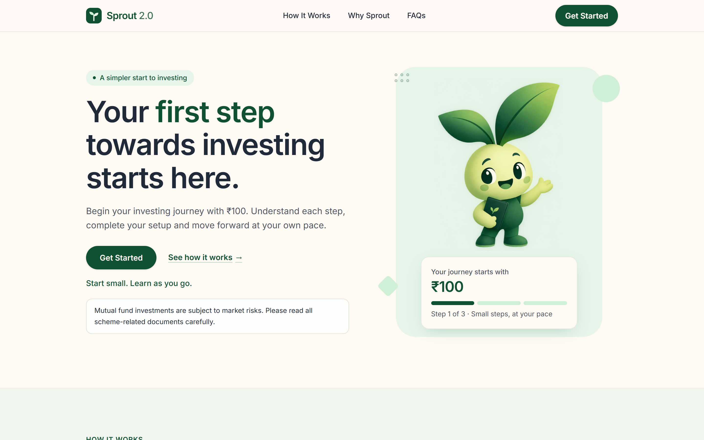

# Sprout 2.0 — UI/UX Case Study
**Small Steps. Big Futures.**  
*Newtonite UI/UX Design Assignment — Responsive Web Application, 5-Step Onboarding Prototype & Design System*

- **Brand:** Sprout 2.0
- **Product Category:** Beginner-friendly mutual fund investing experience for first-time investors in India (starting from ₹100)
- **Deliverables Included:**
  - Production-building React 19 + TypeScript + Tailwind CSS 4 web application (`src/`)
  - Responsive Desktop (`1440px`) and Mobile (`390px`) Homepage (`/`)
  - Interactive 5-Screen Onboarding Prototype (`/onboarding/1` to `/onboarding/5`) with English and prototype Hindi (`हिंदी`) support
  - Figma Design System & Handoff Kit (`docs/figma-handoff.md`, `design/figma-assets/`, `design/figma-import-svgs/`)
  - User-Provided Figma Design File: https://www.figma.com/design/67FVguQmfCpgOL2XGjKZge/Sprout-2.0-%E2%80%94-Newtonite-UI-UX-Assignment
  - User-Provided Figma Interactive Prototype: https://www.figma.com/proto/67FVguQmfCpgOL2XGjKZge/Sprout-2.0-%E2%80%94-Newtonite-UI-UX-Assignment?node-id=1-652&t=cLwORpH5vwAoZTcK-1

> **Mandatory Market-Risk Disclaimer:** Mutual fund investments are subject to market risks. Please read all scheme-related documents carefully.

---

## Page 1 — Cover & Executive Overview

### Project Summary
**Sprout 2.0** (*"Small Steps. Big Futures."*) is a redesigned acquisition and onboarding experience for first-time mutual fund investors in India, built around an approachable **₹100** starting threshold. Rather than overwhelming beginners with dense financial jargon, dark trading-terminal aesthetics, or unexpected document walls mid-registration, Sprout 2.0 pairs a warm, editorial visual system (`#FFF9F4` Warm Cream and `#0F5132` Forest Green) with transparent KYC preparation, bilingual (English / `हिंदी` prototype) accessibility, and clear market-risk communication.

### Core Deliverables at a Glance
| Deliverable | Implementation Status | Source Location / Reference |
|---|---|---|
| **Responsive Homepage** | Implemented & Audited (`360px`–`1440px`) | `src/pages/Home.tsx`, `src/components/*` |
| **5-Step Onboarding Flow** | Implemented (Welcome, Get Ready, Mobile/OTP, KYC, Pending) | `src/pages/onboarding/Step1Welcome.tsx` – `Step5Pending.tsx` |
| **Hindi (`हिंदी`) Prototype** | Implemented across all 5 onboarding screens | `src/onboarding/i18n.ts`, `LanguageSelector.tsx` |
| **Visual & Mascot System** | Consistent geometric Sprout mascot (`86 KB` WebP) + SVG icons | `src/assets/sprout-mascot.webp`, `design/figma-assets/` |
| **Figma Design & Prototype** | User-provided Figma design file & clickable prototype link | Documented in `docs/figma-handoff.md` |



---

## Page 2 — Problem Statement & Project Objectives

### 2.1 Context & Problem Statement
First-time retail investors in India frequently download investing apps out of curiosity, yet abandon the journey before completing identity verification (KYC) or making their first investment. For a beginner who has never invested in mutual funds, three compounding barriers stall progress:
1. **High perceived financial barrier:** Assuming investing requires thousands of rupees rather than a small starting amount like **₹100**.
2. **Unexpected KYC friction:** Discovering mid-flow that a **PAN card**, **Aadhaar card**, and an **Aadhaar-linked mobile number** are required for regulatory verification, forcing users to exit the app to hunt for physical documents.
3. **Intimidating visual & linguistic tone:** English-only interfaces filled with dense terminology, complex charts, or fine-print risk disclosures hidden at the very bottom of the page.

### 2.2 Project Objectives
1. **Clarify the ₹100 entry point immediately:** Communicate on both the Desktop and Mobile homepage hero that users can start learning and investing from **₹100**, paired with an upfront, high-contrast market-risk disclaimer.
2. **Eliminate surprise document walls:** Introduce a clear **"Keep these ready"** checklist (PAN card, Aadhaar card, and Aadhaar-linked mobile number) both on the public homepage and in **Onboarding Step 2** before any form input is requested.
3. **De-escalate KYC anxiety through progressive disclosure:** Break onboarding into **five focused, single-purpose screens** with a visible 5-segment progress bar, plain-language explanations of *why* identity details are required by financial regulations, and format guidance (`ABCDE1234F`).
4. **Support linguistic inclusivity:** Provide an immediate **English / हिंदी** language selector on Onboarding Screen 1 (`Welcome`), loading `Noto Sans Devanagari` for Hindi users while transparently noting that the Hindi translation is a prototype.
5. **Maintain strict prototype & regulatory honesty:** Never claim guaranteed returns, never collect or transmit real personal data in a prototype, and visibly label simulated OTP and PAN format checks as **demo-only**.

---

## Page 3 — Existing Funnel & Problem Diagnosis

### 3.1 Supplied Baseline Funnel Figures
The assignment establishes three baseline funnel volume figures for the existing product:
- **Total App Downloads:** `40,000`
- **KYC Completions:** `9,000`
- **First Investments Completed:** `3,000`

### 3.2 Calculated Conversion & Drop-Off Rates (With Exact Denominators)

| Funnel Metric | Formula (`Numerator ÷ Denominator`) | What the Denominator Represents | Conversion Rate | Drop-Off Volume & Rate |
|---|---|---|---|---|
| **1. Download $\rightarrow$ KYC Completion** | `9,000 ÷ 40,000` | All `40,000` users who downloaded the app | **22.50%** | **31,000 users lost** (**77.50%** of downloads drop off before finishing KYC) |
| **2. KYC Completion $\rightarrow$ First Investment** *(Stage-to-Stage)* | `3,000 ÷ 9,000` | Only the `9,000` users who successfully completed KYC | **33.33%** ($\frac{1}{3}$) | **6,000 users lost** (**66.67%** of KYC-verified users do not make a first investment) |
| **3. Download $\rightarrow$ First Investment** *(End-to-End)* | `3,000 ÷ 40,000` | All `40,000` users who downloaded the app | **7.50%** | **37,000 users lost** (**92.50%** cumulative attrition from download to first investment) |

### 3.3 Diagnostic Breakdown of the Two Drop-Off Zones

```
[ 40,000 Downloads (100.0%) ]
       │
       ├──► 31,000 Drop Off Pre-KYC (77.5% of downloads)
       │    Diagnosis (Hypothesis): Unprepared for PAN/Aadhaar requirements,
       │    uncertain about why identity data is requested, or language friction.
       ▼
[ 9,000 KYC Completions (22.5% of downloads) ]
       │
       ├──► 6,000 Drop Off Post-KYC (66.7% of KYC-verified users; 15.0% of downloads)
       │    Diagnosis (Hypothesis): Unclear next steps after verification pending state,
       │    or intimidation around how much money is needed to start.
       ▼
[ 3,000 First Investments (7.5% of downloads | 33.3% of KYC-verified users) ]
```

- **Primary Leak (Pre-KYC — 31,000 users / 77.5% of downloads):** Over three-quarters of everyone who downloads the app never completes KYC. Addressing this stage requires setting document expectations *before* form entry and making mobile/PAN steps approachable.
- **Secondary Leak (Post-KYC — 6,000 users / 66.67% of KYC completions):** Two-thirds of users who invest the effort to complete KYC still fail to make a first investment. Addressing this stage requires reinforcing the low **₹100** starting step and providing a clear, reassuring **Verification Pending (Step 5)** summary screen so users understand what happens next.

---

## Page 4 — Research Evidence, Limitations & Assumptions

### 4.1 Distinction Between Supplied Facts, Hypotheses, and Design Decisions
To maintain rigorous product integrity, this case study strictly separates **supplied assignment facts** from **working hypotheses**, **implemented design decisions**, and **proposed future experiments**:

| Category | Evidence / Statement | Source / Status |
|---|---|---|
| **Supplied Fact** | Funnel comprises `40,000` downloads, `9,000` KYC completions (`22.5%`), and `3,000` first investments (`7.5%` of downloads; `33.33%` of KYC completions). | Assignment brief |
| **Supplied Fact** | Prior research consists of a **survey of 40 existing users**, which **excluded users who dropped off**. | Assignment brief |
| **Supplied Fact** | Product proposition is a beginner-friendly Indian investing app starting from **₹100**, using the **Sprout 2.0** brand (*"Small Steps. Big Futures."*). | Assignment brief |
| **Methodological Limitation** | **Survivorship Bias:** Because the `40`-user survey only sampled *existing users* and excluded the `37,000` users who dropped out (`31,000` pre-KYC + `6,000` post-KYC), it cannot directly observe the exact moment or reason non-converters abandoned the flow. | Analytical constraint |
| **Methodological Limitation** | **Small Sample Size ($n = 40$):** Represents `0.1%` of total downloads (`40 ÷ 40,000`) and `1.33%` of active investors (`40 ÷ 3,000`), which is directional rather than statistically representative across regions and language groups. | Analytical constraint |
| **Design Hypothesis H1** | Showing an upfront, un-gated document readiness checklist (PAN, Aadhaar, linked mobile) on the homepage and Step 2 will reduce mid-form abandonment caused by missing documents. | To be validated post-launch |
| **Design Hypothesis H2** | Explaining *why* PAN/Aadhaar are required in plain language and showing the exact 10-character PAN format (`ABCDE1234F`) will lower input error rates on Step 4. | To be validated post-launch |
| **Design Hypothesis H3** | Offering an immediate **English / हिंदी** toggle on Step 1 and anchoring the value proposition around **₹100** will reduce early bounce among first-time investors. | To be validated post-launch |

### 4.2 Why No Qualitative Quotes or Survey Percentages Are Fabricated
In accordance with evidence-based UX practice, **no fictional user personas, fabricated interview quotes, or invented survey percentages are included in this case study**. Instead, every screen decision is traced directly to:
1. Structural friction points visible in the `40,000 → 9,000 → 3,000` funnel math,
2. Regulatory and technical realities of Indian mutual fund KYC (PAN format `^[A-Z]{5}[0-9]{4}[A-Z]$`, `+91` 10-digit mobile OTP, Aadhaar readiness, SEBI market-risk disclosure), and
3. Testable hypotheses designed for post-launch instrumentation.

---

## Page 5 — UX Strategy & Design Principles

### 5.1 Four Guiding UX Principles

1. **Preparation Before Commitment**
   - *Problem addressed:* Users hit a wall when asked for a PAN number or Aadhaar OTP they do not have in hand.
   - *Design response:* Both the homepage (`Checklist.tsx`) and Onboarding Step 2 (`Step2Ready.tsx`) present a calm, non-blocking checklist of the three required items (**PAN card**, **Aadhaar card**, **Mobile number linked to Aadhaar**) before any form field appears. Step 2's checklist is interactive (`0 of 3 ready` to `3 of 3 ready`) but explicitly states: *"This list is only a guide. Nothing is checked or stored."*

2. **One Cognitive Task Per Screen**
   - *Problem addressed:* Multi-part forms combining phone numbers, OTPs, PAN inputs, and declarations on a single long scroll create cognitive overload on mobile (`360px`–`430px`) viewports.
   - *Design response:* The onboarding flow is divided into **5 dedicated screens** (`Welcome` → `Get Ready` → `Mobile Verification` → `KYC Details` → `Verification Pending`) governed by a persistent 5-segment progress indicator (`Step X of 5`). Every screen fits comfortably within a standard `390 × 844` mobile viewport without cramped controls.

3. **Radical Honesty About Risk & Prototype Scope**
   - *Problem addressed:* Over-promising returns erodes trust and violates financial norms; pretending a prototype performs live KYC creates privacy risks.
   - *Design response:*
     - Every screen displays the mandatory market-risk disclaimer: *"Mutual fund investments are subject to market risks. Please read all scheme-related documents carefully."*
     - The onboarding header carries a persistent `Prototype · demo only` (`प्रोटोटाइप · केवल डेमो`) pill badge.
     - Step 3 (`Step3Mobile.tsx`) and Step 4 (`Step4Kyc.tsx`) display explicit `DemoNotice` banners warning users **not** to enter real phone numbers, PANs, or Aadhaar numbers, and providing a one-tap **Use sample PAN** (`ABCDE1234F`) helper.

4. **Warm, Non-Intimidating Craft**
   - *Problem addressed:* Cold neon-on-black fintech interfaces signal high-frequency trading rather than beginner-friendly learning.
   - *Design response:* A warm cream canvas (`#FFF9F4`), deep forest green primary actions (`#0F5132`), soft mint containers (`#E6F4EA`), and a single consistent geometric Sprout mascot guide the user from the homepage hero through Step 1 and Step 5.

---

## Page 6 — Visual Identity, Design System & Accessibility

### 6.1 Brand Colour Palette (`src/styles/global.css`)

| Swatch & Token | CSS Variable | HEX | RGB | Verified Contrast Ratio & Usage |
|---|---|---|---|---|
| **Forest Green** | `--color-forest` | `#0F5132` | `rgb(15, 81, 50)` | **`8.9:1` on Cream `#FFF9F4`** \| **`8.1:1` on Mint `#E6F4EA`** \| Primary CTAs, wordmark, active progress bars, focus rings (`3px solid`), footer |
| **Mint Green** | `--color-mint` | `#E6F4EA` | `rgb(230, 244, 234)` | Hero mascot backdrop, Getting Ready container, checked `CheckRow` fill (`bg-mint/70`), hover states |
| **Light Green** | `--color-light-green` | `#CFEFD6` | `rgb(207, 239, 214)` | **`7.1:1` with Forest text** \| Step icon badges, upcoming progress segments, `DemoNotice` banner (`bg-light-green/50`) |
| **Warm Cream** | `--color-cream` | `#FFF9F4` | `rgb(255, 249, 244)` | Global page background, step cards, primary button text |
| **Charcoal** | `--color-charcoal` | `#1F2937` | `rgb(31, 41, 55)` | **`14.1:1` on Cream `#FFF9F4`** (`text-charcoal/80` = **`9.7:1`**) \| All headings and body copy |
| **Validation Error** | *(Functional token)* | `#B42318` | `rgb(180, 35, 24)` | **`6.1:1` on Cream `#FFF9F4`** \| Invalid field borders and `FieldError` messages |

### 6.2 Typography & Spacing System
- **Font Stack:** Self-hosted `@fontsource-variable/inter` for Latin copy and lazy-loaded `@fontsource-variable/noto-sans-devanagari` when `हिंदी` is selected (`src/onboarding/OnboardingProvider.tsx`).
- **Type Scale:**
  - **Hero H1:** `60px` desktop (`3.75rem`) / `36px` mobile (`2.25rem`), SemiBold (`600`), line-height `1.12`, tracking `-0.025em`.
  - **Section H2:** `36px` desktop / `30px` mobile, SemiBold (`600`).
  - **Onboarding Step H1:** `36px` desktop / `28px` mobile (`1.75rem`), SemiBold (`600`), line-height `1.25`.
  - **Body & Controls:** `18px` lead paragraphs (`leading-relaxed`), `16px` body copy, inputs, and buttons (`font-semibold`), `14px` helper notes and risk disclaimers (`leading-relaxed`).
- **Spacing & Radii:** 4px/8px spatial grid (`max-w-6xl` `1152px` marketing container; `max-w-2xl` `672px` onboarding container), `rounded-full` pill buttons (`min-h-12` / `48px`), `rounded-xl` (`12px`) inputs and OTP boxes, `rounded-2xl` (`16px`) cards.

### 6.3 Accessibility & Inclusive Design Guarantees
- **WCAG 2.1 AA Contrast:** Every text pairing exceeds the `4.5:1` normal-text threshold (ranging from `6.1:1` for error text to `14.1:1` for primary body copy).
- **Touch Target Ergonomics:** `@media (pointer: coarse)` enforces `min-height: 44px` on interactive links/buttons, while primary CTAs and inputs are `48px` (`min-h-12`) and OTP boxes/checklist cards are `56px` (`h-14` / `min-h-14`).
- **Keyboard & Screen Reader Support:** `:focus-visible` renders a `3px solid #0F5132` outline with `3px` offset; programmatic focus shifts to the `<h1>` on onboarding step changes (`OnboardingLayout.tsx`) and to the first invalid input on form submission; mobile navigation drawer supports `Escape` to close and locks background scroll.
- **Reduced Motion:** `@media (prefers-reduced-motion: reduce)` disables smooth scroll and collapses transition durations to `0.01ms`.

---

## Page 7 — Responsive Homepage Design (`390px` Mobile & `1440px` Desktop)

### 7.1 Information Architecture & Section Flow
The homepage (`src/pages/Home.tsx`) is structured to answer a first-time investor's questions in natural reading order before asking them to begin onboarding:
1. **Sticky Navbar (`Navbar.tsx`):** Custom geometric Sprout wordmark (`Logo.tsx`), anchor links (*How It Works*, *Why Sprout*, *FAQs*), **Get Started** CTA (`/onboarding/1`), and an accessible mobile menu drawer.
2. **Hero Section (`Hero.tsx`):**
   - **Left Column:** Eyebrow pill (*"A simpler start to investing"*), headline (*"Your **first step** towards investing starts here."*), value proposition introducing **₹100**, primary **Get Started** button + *See how it works →* secondary link, and a bordered **above-the-fold Market-Risk Disclaimer card**.
   - **Right Column (`HeroArt`):** Rounded mint backdrop (`rounded-[2.5rem]`) featuring the Sprout mascot (`src/assets/sprout-mascot.webp`) and the illustrative *"Your journey starts with ₹100"* card.
3. **How It Works (`HowItWorks.tsx`):** Three-card sequence (*Step 1: Get started*, *Step 2: Complete verification*, *Step 3: Explore investing*) with custom `24×24` SVG icons inside `48×48px` `#CFEFD6` containers.
4. **Why Sprout (`WhySprout.tsx`):** Editorial two-column layout pairing the section heading with four numbered principles (*Start with ₹100*, *Simple, beginner-friendly guidance*, *Clear verification instructions*, *Transparent about risk*).
5. **Getting Ready Checklist (`Checklist.tsx`):** Mint container (`bg-mint`) displaying three cream cards for **PAN card**, **Aadhaar card**, and **Mobile number linked to Aadhaar** so visitors know what documents are needed before clicking *Get Started*.
6. **FAQs (`Faq.tsx`) & Footer (`Footer.tsx`):** Four-item accessible accordion (`aria-expanded`, `aria-controls`, first item open by default) followed by a high-contrast `#0F5132` footer repeating the full market-risk disclosure.

### 7.2 Visual Evidence — Desktop (`1440px`) & Mobile (`390px`) Renders
- **Desktop Above-the-Fold (`1440 × 900`):** `design/screenshots/02-homepage-desktop-1440x900-fold.png`
- **Desktop Full Page (`1440 × 3080`):** `design/screenshots/02-homepage-desktop-1440-full.png`
- **Mobile Above-the-Fold (`390 × 844`):** `design/screenshots/01-homepage-mobile-390x844-fold.png`
- **Mobile Full Page (`390 × 3530`):** `design/screenshots/01-homepage-mobile-390-full.png`

---

## Page 8 — Five-Screen Onboarding Flow & Hindi (`हिंदी`) Support

### 8.1 Screen-by-Screen Specification & Funnel Role

| Step & Route | Screen Title (EN / HI) | Core User Action & Validation | Funnel Problem Addressed | Screenshot Evidence |
|---|---|---|---|---|
| **Step 1** `/onboarding/1` | *Your investing journey starts here.* / *आपकी निवेश यात्रा यहीं से शुरू होती है।* | Select language (`English` or `हिंदी`), view Sprout mascot, click **Continue** or `← Back to home`. | Welcomes beginners calmly; provides immediate native-script option for Hindi readers. | `03-onboarding-1-welcome-390x844.png`, `03b-onboarding-1-welcome-hindi-390x844.png` |
| **Step 2** `/onboarding/2` | *A few things before we begin* / *शुरू करने से पहले कुछ बातें* | Interactive 3-item readiness checklist (PAN, Aadhaar, linked mobile) with live `X of 3 ready` pill. Non-blocking guide. | Prevents surprise mid-flow drop-off (`77.5%` pre-KYC leak) by setting document expectations upfront. | `04-onboarding-2-get-ready-390x844.png` |
| **Step 3** `/onboarding/3` | *Verify your mobile number* / *अपना मोबाइल नंबर सत्यापित करें* | **3 Sub-states:**<br>• **3A (`enter`):** `+91` prefix + 10-digit numeric validation.<br>• **3B (`otp`):** 6-digit `OtpInput` (supports paste, arrow keys, backspace).<br>• **3C (`done`):** Read-only verified banner. | Breaks phone verification into predictable micro-steps with clear `Change number` recovery and explicit demo notices. | `05a-onboarding-3-mobile-entry-390x844.png`, `05b-onboarding-3-otp-390x844.png`, `05c-onboarding-3-verified-390x844.png` |
| **Step 4** `/onboarding/4` | *Let’s prepare your KYC details* / *आइए आपकी केवाईसी जानकारी तैयार करें* | Uppercase PAN format check (`^[A-Z]{5}[0-9]{4}[A-Z]$`), one-tap **Use sample PAN** (`ABCDE1234F`), and Aadhaar readiness confirmation checkbox. | Demystifies PAN syntax errors; never asks for raw Aadhaar numbers in the prototype; keeps PAN strictly in local component state. | `06-onboarding-4-kyc-details-390x844.png` |
| **Step 5** `/onboarding/5` | *You’re ready for the next step* / *आप अगले चरण के लिए तैयार हैं* | Displays Sprout mascot, prototype confirmation notice, and dynamic **What you practised** summary card (`Checklist`, `Mobile step`, `PAN`). | Addresses the `66.67%` post-KYC drop-off by summarizing progress and providing clear **Review details** and **Back to homepage** actions. | `07-onboarding-5-pending-390x844.png` |

### 8.2 Hindi (`हिंदी`) Prototype Implementation
- Selecting **हिंदी** on Screen 1 switches the entire 5-screen onboarding dictionary (`src/onboarding/i18n.ts`), updates `<html lang="hi">`, and dynamically imports `@fontsource-variable/noto-sans-devanagari` (`OnboardingProvider.tsx`) so English-only visitors do not pay the Devanagari font download cost until requested.
- A persistent notice banner informs users: *"हिंदी अनुवाद प्रोटोटाइप है और अधूरा हो सकता है। / The Hindi translation is a prototype and may be incomplete."*

---

## Page 9 — Prototype, Implementation, Testing & Performance

### 9.1 Technical Architecture & Prototype Safeguards
- **Frontend Stack:** React `19.2.8`, TypeScript `~6.0.2`, Vite `8.3.0`, and Tailwind CSS `4.3.3` (`@tailwindcss/vite`), with zero heavy UI component libraries or animation frameworks.
- **Lightweight Custom History Router (`src/router.ts`):** Uses browser `History API` (`pushState` / `popstate` + `useSyncExternalStore`) supporting clean URLs (`/`, `/onboarding/1`–`/onboarding/5`) and automatic scroll-to-top on route transitions.
- **Strict Prototype Privacy Architecture:**
  - **No network calls or persistence:** Neither phone numbers, OTP digits, nor sample PAN strings are ever written to `localStorage`, `sessionStorage`, cookies, URL query strings, or network endpoints.
  - **Ephemeral PAN state (`Step4Kyc.tsx`):** The PAN input string is stored solely in local `useState('')` inside `Step4` and is garbage-collected the moment the user navigates to Step 5; shared context (`OnboardingProvider.tsx`) only records a boolean `panFormatChecked: boolean`.

### 9.2 Production Build & Asset Footprint (Measured from `npm run build`)
Executed via `tsc -b && vite build` (Vite v8.3.4) and `oxlint`:
- **Linter & Typecheck:** `0 warnings and 0 errors` across 30 files (`11ms` execution).
- **HTML Entry (`dist/index.html`):** `0.66 kB` (`0.39 kB` gzipped).
- **Main CSS Bundle (`dist/assets/index-*.css`):** `32.76 kB` (`6.93 kB` gzipped).
- **Lazy-Loaded Devanagari CSS (`dist/assets/noto-sans-devanagari-*.css`):** `1.07 kB` (`0.43 kB` gzipped; fetched only when `हिंदी` is selected).
- **JavaScript Bundle (`dist/assets/index-*.js`):** `266.80 kB` (`81.60 kB` gzipped, including React 19 runtime and all application routes/translations).
- **Mascot Illustration (`dist/assets/sprout-mascot-*.webp`):** `86.19 kB` (`532 × 720` lossless transparent WebP).

### 9.3 Quality Audit & Figma Deliverables
- **Cross-Viewport Verification:** Audited across `360px`, `390px`, `430px`, and `1440px` viewports for zero horizontal overflow, `≥ 44px` tap targets, keyboard navigation (`Tab`, `Shift+Tab`, `Escape`, arrow keys in OTP boxes), and screen-reader landmarks.
- **Figma Design & Interactive Prototype Links (User-Provided):**
  - **Figma Design File:** https://www.figma.com/design/67FVguQmfCpgOL2XGjKZge/Sprout-2.0-%E2%80%94-Newtonite-UI-UX-Assignment
  - **Figma Prototype:** https://www.figma.com/proto/67FVguQmfCpgOL2XGjKZge/Sprout-2.0-%E2%80%94-Newtonite-UI-UX-Assignment?node-id=1-652&t=cLwORpH5vwAoZTcK-1
  - *(Note: Links above are the user-created Figma cloud links from the handoff kit; evaluators should verify public view permissions in an incognito browser window.)*

---

## Page 10 — Three-Week Launch Plan, Risks, Success Metrics & Conclusion

### 10.1 Realistic Three-Week Rollout Plan (Single Frontend Developer)

| Week | Focus Area | Concrete Engineering & UX Tasks | Milestone Deliverable |
|---|---|---|---|
| **Week 1** *(Days 1–5)* | **Design System, Tokens & Responsive Homepage** | • Finalize CSS variables (`#0F5132`, `#E6F4EA`, `#CFEFD6`, `#FFF9F4`, `#1F2937`), focus rings, and `prefers-reduced-motion` rules.<br>• Build `Navbar`, `Hero` (with above-the-fold risk card & mascot), `HowItWorks`, `WhySprout`, `Checklist`, `Faq` accordion, and `Footer`.<br>• Verify responsive layout across `360px`, `390px`, `768px`, and `1440px`. | Production-ready Homepage (`/`) passing WCAG AA contrast and mobile usability checks. |
| **Week 2** *(Days 6–10)* | **5-Step Onboarding Flow & Bilingual (`हिंदी`) Support** | • Implement `OnboardingLayout`, 5-segment progress bar, and shared context.<br>• Build Steps 1–5 including `+91` phone input, 6-box `OtpInput` (keyboard + paste support), PAN regex check + sample filler, and summary card.<br>• Add `i18n.ts` English/Hindi dictionary and lazy-loaded `Noto Sans Devanagari`. | Complete interactive 5-step onboarding prototype (`/onboarding/1`–`5`) in EN & HI. |
| **Week 3** *(Days 11–15)* | **QA Hardening, Analytics Hooks & Launch Readiness** | • Conduct end-to-end keyboard, screen-reader (`aria-invalid`, `aria-describedby`, `role="status"`), and slow-3G asset loading audits.<br>• Integrate privacy-safe funnel analytics events (see Section 10.2) and connect staging KYC/OTP APIs behind feature flags.<br>• Review Hindi copy with a native financial translator and deploy staged rollout. | Instrumented release candidate ready for staged cohort launch. |

### 10.2 Proposed Success Metrics & Measurement Methodology (No Fabricated Results)
Because Sprout 2.0 is a pre-launch design and frontend prototype, **no post-launch conversion improvements or A/B test results are claimed**. In a live rollout, impact would be evaluated over a 30-day cohort window using the following instrumented metrics:

| Proposed Metric | Exact Measurement Formula (`Numerator ÷ Denominator`) | Instrumentation & Event Tracking Method | Target Hypothesis Tested |
|---|---|---|---|
| **1. Onboarding Start Rate** | `Unique users viewing /onboarding/1 ÷ Unique homepage visitors (/)` | Client route event `onboarding_step_viewed { step: 1 }` divided by unique session entries on `/`. | Tests whether the **₹100** hero framing and upfront checklist increase willingness to start. |
| **2. Step-by-Step Completion & Pre-KYC Conversion** | `Users completing KYC ÷ Users downloading/starting onboarding` *(Baseline: `9,000 ÷ 40,000 = 22.50%`)* | Funnel step events `step_1_completed` through `step_5_reached`, segmented by whether the user interacted with Step 2's checklist. | Tests **H1** (whether upfront document preparation reduces the `77.50%` pre-KYC drop-off). |
| **3. PAN Input First-Attempt Pass Rate** | `Step 4 submissions passing regex on 1st click ÷ Total Step 4 submission attempts` | Client validation counter `kyc_pan_validation_error` (tracks boolean pass/fail only—**never logs the PAN string**). | Tests **H2** (whether format hints reduce input errors on Step 4). |
| **4. Post-KYC First Investment Rate** | `KYC-verified users making ≥ ₹100 first investment within 14 days ÷ Total KYC-verified users` *(Baseline: `3,000 ÷ 9,000 = 33.33%`)* | Server-side order settlement event joined with `kyc_verified` cohort timestamp. | Tests whether clear post-KYC status messaging and the ₹100 entry point reduce the `66.67%` post-KYC drop-off. |
| **5. Hindi (`हिंदी`) Adoption & Completion Parity** | `Step 5 completion rate for lang='hi' sessions vs. lang='en' sessions` | Session property `selected_language: 'en' \| 'hi'` emitted on Step 1 toggle. | Tests **H3** (whether Hindi support closes completion gaps for non-English-first users). |

### 10.3 Key Risks & Mitigations
1. **Prototype Hindi Translation Nuance:** The current Hindi copy is marked as a prototype (`हिंदी अनुवाद प्रोटोटाइप है और अधूरा हो सकता है।`). *Mitigation:* Complete a professional financial-literacy localization review before production release.
2. **Real-World SMS / UIDAI Latency:** Live OTP delivery and regulatory KYC verification introduce network delays and third-party failures not present in a local demo. *Mitigation:* Add explicit retry timers, offline state preservation, and asynchronous status notifications in production.
3. **Survivorship Bias in Historical Research:** Because the initial 40-user survey excluded drop-offs, early launch cohorts should include an optional 1-tap exit poll when users leave Step 2, 3, or 4 to capture real drop-off reasons.

### 10.4 Conclusion
Sprout 2.0 demonstrates that designing for first-time Indian investors does not require gamified gimmicks or return promises. By combining a calm **Warm Cream & Forest Green** design system, upfront **PAN/Aadhaar preparation**, progressive **5-step onboarding** in **English and हिंदी**, and unambiguous **market-risk transparency**, the product directly addresses the `77.50%` pre-KYC and `66.67%` post-KYC funnel drop-offs while remaining fast, accessible, and honest.
